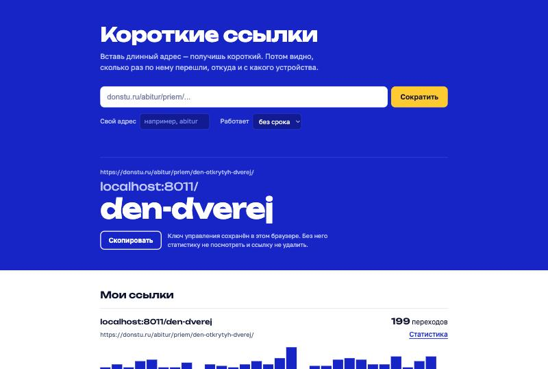
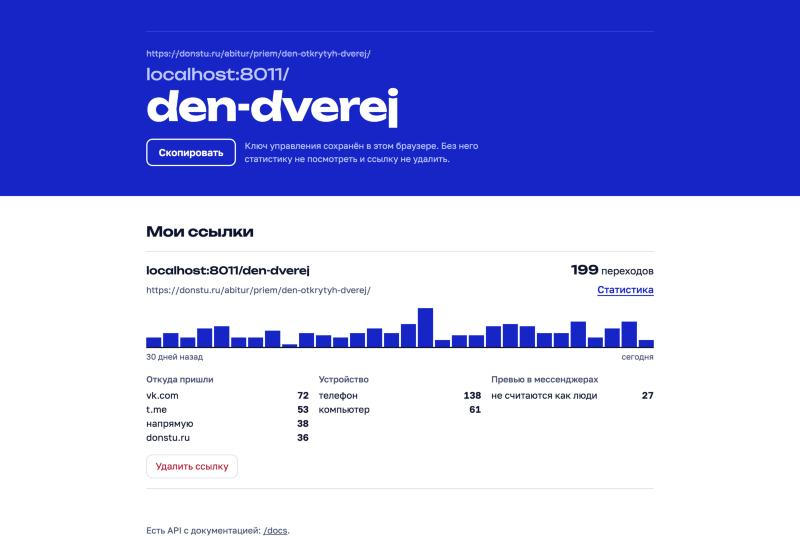

# Короткие ссылки

Сервис коротких ссылок со статистикой переходов: FastAPI, PostgreSQL, Redis, Docker.





## Что умеет

- Сокращает ссылку до кода из 7 символов или до своего псевдонима (`/abitur`).
- Даёт ссылке срок жизни. После него сервер отвечает `410 Gone`.
- Считает переходы: по дням за 30 дней, откуда пришли (vk.com, t.me…), с телефона или с компьютера.
- Учитывает **превью в мессенджерах** отдельно от людей. Когда ссылку кидают в Телеграм, бот Телеграма открывает её сам, и без этой проверки статистика врала бы.
- Выдаёт при создании ключ управления. Без ключа нельзя ни посмотреть статистику, ни удалить ссылку.
- Ограничивает создание ссылок: не больше N в минуту с одного IP.

## Запуск

```bash
docker compose up --build
# http://localhost:8000 — страница, http://localhost:8000/docs — Swagger
```

Без Docker, на SQLite и кэше в памяти:

```bash
python -m venv .venv && source .venv/bin/activate
pip install -r requirements-dev.txt
uvicorn app.main:app --reload
pytest
```

## API

| Метод | Путь | |
|---|---|---|
| `POST` | `/api/links` | `{url, alias?, expires_in_days?}` → `{code, short_url, manage_token, …}` |
| `GET` | `/{code}` | `302` на исходный адрес |
| `GET` | `/api/links/{code}/stats` | статистика, заголовок `X-Manage-Token` |
| `DELETE` | `/api/links/{code}` | удаление, заголовок `X-Manage-Token` |

## Решения, которые стоит объяснить

**302, а не 301.** Браузер кэширует 301 навсегда, и следующие переходы шли бы
мимо сервиса, то есть мимо статистики.

**Сначала редирект, потом запись клика.** Клик пишется в `BackgroundTasks`
уже после ответа, поэтому человек не ждёт базу. Счётчик увеличивается одним
SQL-запросом `clicks_total = clicks_total + 1`: при одновременных переходах
ни один не теряется.

**Redis как кэш горячего пути.** `код → адрес` лежит в Redis с TTL. TTL не
дольше срока жизни ссылки, поэтому просроченная ссылка не переживёт себя в кэше.
При удалении ссылки ключ из кэша тоже удаляется. Тот же Redis считает лимиты
по фиксированному окну (`INCR` + `EXPIRE` в одной транзакции).
Без `REDIS_URL` вместо Redis работает реализация в памяти с тем же интерфейсом.
На ней же идут тесты.

**Коды без похожих символов.** Алфавит без `0/O`, `1/l/I`, поэтому код
со слайда или с бумажки перепечатывается без ошибок. 57⁷ ≈ 2·10¹² вариантов.
Уникальность проверяет индекс в базе, а при коллизии код просто
генерируется заново, без отдельного «а не занят ли».

**Ключ управления хранится как хэш.** В базе лежит SHA-256 ключа, сравнение идёт
через `secrets.compare_digest`. На неверный ключ сервер отвечает 404, а не 403,
чтобы перебором нельзя было узнать, какие коды существуют.

**Проверка адресов.** Сервис принимает `donstu.ru/abitur` без схемы. Он не
принимает `javascript:`, `ftp:`, а также ссылки на самого себя, потому что
такая ссылка дала бы бесконечный редирект.

## Структура

```
app/
  main.py        фабрика приложения, lifespan
  routes.py      эндпоинты
  models.py      Link, Click (SQLAlchemy 2, async)
  cache.py       Cache: RedisCache и MemoryCache, rate limit
  codes.py       генерация кодов, проверка ссылок и псевдонимов, токены
  useragent.py   телефон / компьютер / бот, домен источника
  static/        страница без фреймворков
tests/           39 тестов на pytest
```

## CI

GitHub Actions прогоняет тесты дважды: на SQLite и на настоящих PostgreSQL 17
и Redis 7, которые поднимаются сервисами в job. Отдельный шаг собирает
Docker-образ.
